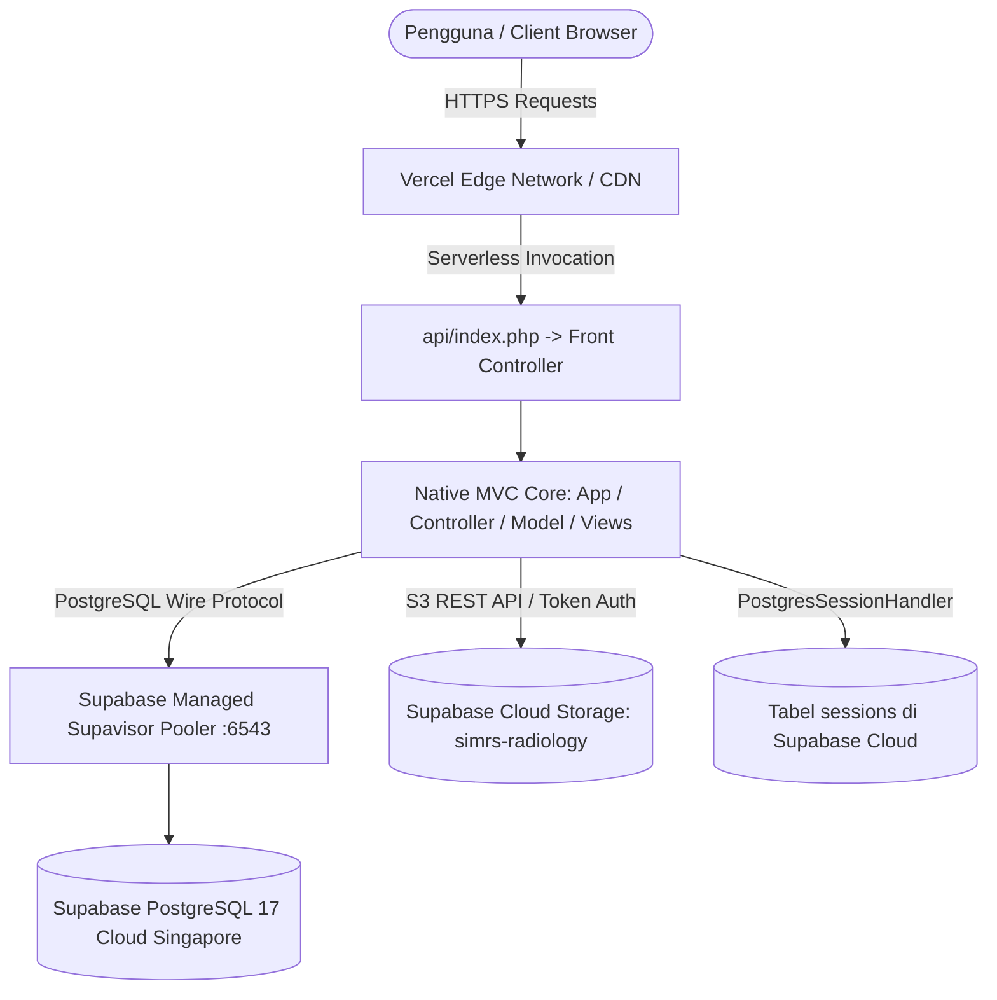

# SIMRS Siloam Peduli
### Sistem Informasi Manajemen Rumah Sakit Terintegrasi (Enterprise Healthcare Management System)

[](https://simrs-nu.vercel.app/)
[](https://supabase.com/)
[](https://www.php.net/)
[](#-arsitektur-sistem--teknologi)
[](#-tentang-sistem)

---

## 📋 Daftar Isi
1. [Tentang Sistem](#-tentang-sistem)
2. [Arsitektur Sistem & Teknologi](#-arsitektur-sistem--teknologi)
3. [Cakupan 16 Modul Utama](#-cakupan-16-modul-utama)
4. [Persyaratan Sistem (Prerequisites)](#-persyaratan-sistem-prerequisites)
5. [Panduan Lengkap Setup Supabase dari Nol](#-panduan-lengkap-setup-supabase-dari-nol)
6. [Generate Database (1-Click Execution)](#-generate-database-1-click-execution)
7. [Konfigurasi Environment (.env)](#-konfigurasi-environment-env)
8. [Panduan Deploy ke Vercel (Langkah demi Langkah)](#-panduan-deploy-ke-vercel-langkah-demi-langkah)
9. [Panduan Menjalankan di Lokal (Development)](#-panduan-menjalankan-di-lokal-development)
10. [Daftar Akun Pengguna Bawaan (Demo Credentials)](#-daftar-akun-pengguna-bawaan-demo-credentials)
11. [Struktur Folder Proyek](#-struktur-folder-proyek)
12. [Troubleshooting & FAQ](#-troubleshooting--faq)

---

## 🏥 Tentang Sistem

**SIMRS Siloam Peduli** adalah platform Sistem Informasi Manajemen Rumah Sakit berbasis web yang dirancang khusus untuk memenuhi standar operasional rumah sakit modern berstandar KARS (Komisi Akreditasi Rumah Sakit) dan regulasi **Permenkes No. 24 Tahun 2022** tentang Rekam Medis Elektronik.

Sistem ini mengintegrasikan seluruh alur layanan klinis, penunjang medis, farmasi, kasir/keuangan, hingga logistik dan pelaporan eksekutif dalam satu ekosistem data yang kohesif, aman, dan berlatensi rendah.

---

## ⚡ Arsitektur Sistem & Teknologi

Sistem dirancang dengan arsitektur **Clean Native MVC (Model-View-Controller)** tanpa bloatware framework berat, menjamin kecepatan eksekusi maksimum dan portabilitas tinggi.



* **Backend Engine**: PHP 8.2 / 8.3 Native MVC (Strict typing, PDO prepared statements, Deny-by-Default RBAC).
* **Database Engine**: Supabase Cloud PostgreSQL 17 (Region: Singapore `ap-southeast-1`), dilengkapi 115+ B-Tree secondary performance indexes.
* **Serverless Edge**: Vercel Serverless Function (`vercel-php@0.7.4`), zero-maintenance cloud hosting.
* **Session Handler**: `PostgresSessionHandler` (Database-driven session) sehingga state login pengguna tetap persisten lintas instance serverless stateless Vercel.
* **Object Storage**: Supabase Storage REST API untuk penyimpanan file citra diagnostik rontgen/radiologi DICOM/PNG/JPG berresolusi tinggi.
* **UI/UX Design**: Antarmuka *Medical Navy* Siloam Peduli resmi, tipografi *Instrument Sans*, Lucide Icons, dan anti-slop design craftsmanship.

---

## 📦 Cakupan 16 Modul Utama

Aplikasi ini mencakup 16 modul layanan rumah sakit terintegrasi:

| No | Modul | Deskripsi & Kemampuan Utama |
| :---: | :--- | :--- |
| **01** | **Autentikasi & RBAC** | Multi-role guard (12 level peran), session timeout otomatis, perlindungan CSRF, dan pencatatan audit log kepatuhan. |
| **02** | **Registrasi Pasien** | Registrasi pasien baru, validasi NIK 16 digit, pencarian pasien instan, master penjamin (Umum, BPJS, Asuransi Swasta), cetak kartu pasien. |
| **03** | **Rekam Medis Elektronik (RME)** | Format SOAP lengkap (Subjektif, Objektif, Asesmen, Plan), riwayat alergi obat/makanan, vital signs, dan rekam medis seumur hidup. |
| **04** | **Triase & Layanan IGD** | Skala Triase ATS/ESI 5 Tingkat warna (Merah/Resusitasi, Kuning/Emergensi, Hijau/Mendesak, Biru/Non-Emergensi, Hitam/Meninggal), monitoring tanda vital berkala IGD. |
| **05** | **Rawat Jalan (Poliklinik)** | Antrean per poli spesialis, input anamnesis dokter, diagnosis ICD-10 & tindakan ICD-9-CM, jadwal kontrol pasca rawat. |
| **06** | **Rawat Inap & Bed Management** | Admisi bangsal rawat inap, visualisasi peta bed (Kosong, Terisi, Dibersihkan, Rusak), mutasi/transfer bed antar ruangan, resume medis pulang. |
| **07** | **CPOE Farmasi & E-Prescription** | Computerized Physician Order Entry resep obat, telaah resep 7 Benar oleh apoteker, peracikan obat puyer/non-racikan, penyerahan obat & edukasi etiket. |
| **08** | **Kasir, Billing & Asuransi** | Kalkulasi tagihan otomatis dari poli, tindakan, lab, radiologi, dan farmasi. Pembayaran multi-metode (Tunai, QRIS, Debit, Kartu Kredit), klaim asuransi swasta & bridging BPJS. Cetak kuitansi ber-watermark resmi. |
| **09** | **Gudang Logistik & Inventori** | Manajemen stok obat/alkes metode FEFO/FIFO, batas minimum stok (Buffer Stock), kartu stok digital, Purchase Request (PR), dan pencatatan penyesuaian opname. |
| **10** | **Laboratorium (LIS)** | Order tes lab klinik, hematologi, kimia darah, urinalisis, verifikasi analis, validasi nilai kritis (Critical Value Alert), dan cetak lembar hasil uji lab resmi. |
| **11** | **Radiologi (RIS & PACS)** | Order pemeriksaan radiologi (X-Ray, CT Scan, USG), upload foto rontgen ke Supabase Cloud Storage, ekspertise dokter spesialis radiologi (Sp.Rad). |
| **12** | **Antrean & Penjadwalan Dokter** | Manajemen jadwal praktik mingguan dokter spesialis, kuota harian pasien, cetak tiket barcode antrean otomatis per poli. |
| **13** | **Nursing Station** | Pengkajian awal keperawatan (Risiko Jatuh Morse/Humpty Dumpty, Skala Nyeri NRS/Wong-Baker), Medication Administration Record (MAR), catatan integrasi SOAP perawat, eskalasi SBAR ke dokter penanggung jawab (DPJP). |
| **14** | **Gizi & Diet Pasien** | Skrining gizi MST (Malnutrition Screening Tool), perencanaan menu diet (Diet Rendah Garam, DM, Lambung, Sonde), monitoring jadwal distribusi makan harian. |
| **15** | **Dashboard Eksekutif & Statistik** | Indikator efisiensi rawat inap (BOR, ALOS, TOI, BTO), tren kunjungan, pendapatan finansial RS harian/bulanan, 10 Besar Morbiditas Penyakit Rawat Jalan & Inap (Kemenkes RL 5.3). |
| **16** | **Master Data & Konfigurasi** | Pengaturan parameter rumah sakit, master tarif tindakan, master obat & alkes, master ruangan & bed, master diagnosis ICD-10, audit trail transaksi. |

---

## 💻 Persyaratan Sistem (Prerequisites)

Sebelum melakukan instalasi, pastikan lingkungan Anda memenuhi spesifikasi berikut:

* **PHP Version**: PHP 8.2 atau PHP 8.3 (Dukungan penuh untuk fitur modern PHP).
* **PHP Extensions**:
  * `pdo`
  * `pdo_pgsql` *(Wajib untuk koneksi ke Supabase PostgreSQL)*
  * `curl` *(Wajib untuk integrasi Supabase Storage API)*
  * `mbstring`
  * `openssl`
  * `json`
* **Cloud Account**:
  * Akun [Supabase](https://supabase.com/) *(Free tier sudah sangat memadai)*
  * Akun [Vercel](https://vercel.com/) *(Untuk opsi deployment serverless)*
  * Akun [GitHub](https://github.com/) *(Untuk menghubungkan repo ke Vercel)*

---

## ☁️ Panduan Lengkap Setup Supabase dari Nol

Ikuti panduan berikut untuk membuat project database cloud dan mendapatkan seluruh kredensial yang dibutuhkan:

### Langkah 1: Buka Dashboard & Buat Proyek Baru
1. Buka browser dan kunjungi: **[https://supabase.com/dashboard](https://supabase.com/dashboard)**.
2. Masuk (Sign in) menggunakan akun Supabase atau login instan dengan GitHub.
3. Di halaman utama dashboard, klik tombol hijau **+ New project**.
4. Isi formulir pembuatan project:
   * **Organization**: Pilih organisasi Anda (atau Default).
   * **Name**: Beri nama project (misal: `SIMRS-Siloam` atau `simrs-production`).
   * **Database Password**: Masukkan password database yang kuat.
     > ⚠️ **PENTING**: Catat dan simpan password ini dengan aman! Password ini adalah nilai untuk **`DB_PASS`** di file `.env`.
   * **Region**: Pilih **Singapore (`ap-southeast-1`)**.
     > 💡 **PENTING**: Region Singapore memberikan latensi tercepat bagi pengguna di Indonesia (~20–50 ms).
   * **Pricing Plan**: Pilih **Free Plan** (atau Pro sesuai kebutuhan rumah sakit).
5. Klik **Create new project** dan tunggu 1–2 menit hingga Supabase selesai menyiapkan server database Anda.

---

### Langkah 2: Mengambil Kredensial Database (Host, Port, User, Password)
Setelah project selesai dibuat:
1. Di bilah menu sebelah kiri bawah, klik icon **Project Settings** (icon roda gigi ⚙️).
2. Pilih submenu **Database**.
3. Gulir ke bawah ke bagian **Connection parameters** atau **Connection pooling**:
   * **Host**: Salin host pooler (misal: `aws-0-ap-southeast-1.pooler.supabase.com`). Ini untuk `DB_HOST`.
   * **Port**: Pilih port **`6543`** *(Transaction / Session Pooler, sangat disarankan untuk arsitektur serverless)*. Ini untuk `DB_PORT`.
   * **Database name**: Biasanya bertuliskan `postgres`. Ini untuk `DB_NAME`.
   * **User**: Salin username database (misal: `postgres.[project-ref]`). Ini untuk `DB_USER`.
   * **Password**: Password yang Anda tentukan di Langkah 1 tadi. Ini untuk `DB_PASS`.

---

### Langkah 3: Mengambil Project URL dan API Key (Storage & REST)
Kredensial ini digunakan untuk fitur upload citra rontgen & hasil pemeriksaan radiologi ke cloud storage:
1. Di **Project Settings**, klik submenu **API**.
2. Perhatikan bagian **Project URL**:
   * Salin URL project (contoh: `https://abcdefghijklmnopqrst.supabase.co`). Ini adalah nilai untuk **`SUPABASE_URL`**.
3. Perhatikan bagian **Project API Keys**:
   * **`anon` / `public`**: Salin key ini (diawali `sb_publishable_...` atau `eyJ...`). Ini untuk **`SUPABASE_ANON_KEY`** / **`SUPABASE_KEY`**.
   * **`service_role` / `secret`**: Klik tombol **Reveal** untuk menampilkan token rahasia ini, lalu salin. Ini untuk **`SUPABASE_SERVICE_ROLE_KEY`**.
     *(Key ini digunakan oleh backend untuk mengunggah citra radiologi secara aman tanpa terhalang RLS)*.

---

### Langkah 4: Membuat Storage Bucket untuk Citra Radiologi
Agar fitur upload foto hasil rontgen di modul Radiologi dapat berjalan:
1. Pada menu di sisi kiri dashboard Supabase, klik menu **Storage** (icon folder/ember).
2. Klik tombol **New bucket**.
3. Isi kolom **Bucket name** persis: **`simrs-radiology`**.
4. Aktifkan toggle **Public bucket** menjadi **ON** (hijau), agar foto rontgen dapat dilihat oleh dokter poliklinik dan dokter spesialis.
5. Klik tombol **Save**.

---

## 🚀 Generate Database (1-Click Execution)

Setelah project Supabase Anda siap dan kredensial sudah dimasukkan ke `.env`, jalankan salah satu dari 2 metode berikut untuk men-generate seluruh 48 tabel, 115 index, dan seeder demo:

### Opsi A: Eksekusi Otomatis via Terminal CLI (Sangat Direkomendasikan ⚡)

Script PHP otomatis sudah disediakan di `database/setup.php`. Script ini membaca kredensial dari `.env`, melakukan koneksi ke Supabase, dan langsung mengeksekusi skema secara otomatis.

Cukup jalankan satu perintah berikut di terminal root proyek:

```bash
php database/setup.php
```

Output eksekusi:
```text
====================================================================
   SIMRS SILOAM PEDULI - SUPABASE DATABASE AUTOMATED SETUP          
====================================================================

Menghubungkan ke PostgreSQL:
 - Host: aws-0-ap-southeast-1.pooler.supabase.com
 - Port: 6543
 - Database: postgres
 - User: postgres.xxxxxx

✓ Koneksi Berhasil! Ping latency: 68.4 ms
Membaca skema master dari database/supabase_schema_complete.sql...
Mengeksekusi skema DDL & Seeder ke Supabase PostgreSQL...

====================================================================
✓ SETUP DATABASE SELESAI DENGAN SUKSES!
 - Total Tabel Terbuat : 48 Tabel
 - Total Indexes Aktif  : 115 Indexes
 - Total Akun Pengguna  : 29 Akun Demo Bawaan
 - Status Server        : Siap Digunakan (Production Ready)
====================================================================
```

---

### Opsi B: Manual via Supabase Dashboard (SQL Editor)

Jika Anda tidak memiliki terminal PHP lokal:
1. Buka dashboard proyek Supabase Anda: [https://supabase.com/dashboard](https://supabase.com/dashboard).
2. Di menu bilah kiri, klik menu **SQL Editor**.
3. Buka file `database/supabase_schema_complete.sql` di text editor Anda.
4. Salin seluruh kodenya (Ctrl+A -> Ctrl+C), lalu tempelkan ke SQL Editor Supabase.
5. Klik tombol hijau **RUN**. Seluruh tabel dan data awal akan selesai dibuat dalam hitungan detik.

---

## ⚙️ Konfigurasi Environment (.env)

Salin file `.env.example` menjadi `.env`:
```bash
cp .env.example .env
```

Isi variabel `.env` dengan kredensial yang telah Anda dapatkan dari Supabase:

```env
# =====================================================================
# SIMRS Siloam Peduli - Environment Configuration
# =====================================================================
APP_NAME="SIMRS Siloam Peduli"
APP_ENV="production"
APP_VERSION="5.1.0"
APP_URL="https://simrs-nu.vercel.app"

# Database Engine: 'pgsql' untuk Supabase PostgreSQL Cloud
DB_CONNECTION="pgsql"

# Supabase Managed PostgreSQL Configuration (Region Singapore ap-southeast-1)
# Rekomendasi: Gunakan Transaction Pooler (Port 6543)
DB_HOST="aws-0-ap-southeast-1.pooler.supabase.com"
DB_PORT="6543"
DB_NAME="postgres"
DB_USER="postgres.xxxxxx"
DB_PASS="PasswordDatabaseSupabaseAnda"
DB_SSLMODE="require"

# Supabase API & Cloud Storage Configuration (Untuk Upload Citra Radiologi)
SUPABASE_URL="https://xxxxxx.supabase.co"
SUPABASE_ANON_KEY="sb_publishable_xxxxxx"
SUPABASE_SERVICE_ROLE_KEY="sb_secret_xxxxxx"
SUPABASE_STORAGE_BUCKET="simrs-radiology"
```

---

## 🌐 Panduan Deploy ke Vercel (Langkah demi Langkah)

Proyek ini telah dikonfigurasi secara *native* agar dapat di-deploy ke Vercel dengan satu klik via file `vercel.json`.

### Langkah 1: Hubungkan Repository ke Vercel
1. Buka [Vercel Dashboard](https://vercel.com/dashboard) dan klik **Add New...** -> **Project**.
2. Pilih repository GitHub yang berisi source code SIMRS ini.
3. Klik **Import**.

### Langkah 2: Konfigurasi Proyek di Vercel
Pada halaman **Configure Project**:
* **Project Name**: Masukkan nama aplikasi (misal: `simrs-siloam` atau biarkan bawaan).
* **Framework Preset**: Pilih **`Other`** *(Konfigurasi runtime PHP dan routing sudah diatur di vercel.json)*.
* **Root Directory**: Biarkan **`./`**.
* **Build and Output Settings**: Biarkan semua toggle tetap **MATI / Default** *(Tidak memerlukan command build khusus)*.

### Langkah 3: Isi Environment Variables
Buka accordion **Environment Variables**, lalu masukkan variabel berikut:

| Nama Variabel (Key) | Nilai (Value) | Keterangan |
| :--- | :--- | :--- |
| `DB_HOST` | `aws-0-ap-southeast-1.pooler.supabase.com` | Host Supabase Pooler |
| `DB_PORT` | `6543` | Port PostgreSQL Pooler |
| `DB_NAME` | `postgres` | Nama database |
| `DB_USER` | `postgres.xxxxxx` | User database Supabase |
| `DB_PASS` | *(Password Database Supabase Anda)* | Password database |
| `DB_SSLMODE` | `require` | Enkripsi SSL database |
| `SUPABASE_URL` | `https://xxxxxx.supabase.co` | Project URL dari Supabase API Settings |
| `SUPABASE_KEY` | *(Publishable / Anon Key Supabase)* | Anon Key |
| `SUPABASE_SERVICE_ROLE_KEY` | *(Secret Service Role Key)* | Secret Service Role Key untuk Storage |
| `APP_ENV` | `production` | Mode aplikasi produksi |

### Langkah 4: Klik Deploy
1. Klik tombol **Deploy**.
2. Tunggu proses build berlangsung (sekitar 30 - 45 detik).
3. Selesai! Vercel akan menerbitkan tautan produksi (contoh: `https://simrs-nu.vercel.app`).

---

## 💻 Panduan Menjalankan di Lokal (Development)

Jika Anda ingin menjalankan aplikasi di komputer lokal:

### 1. Menggunakan PHP Built-in Server (Paling Cepat)
Pastikan PHP 8.2+ dengan ekstensi `pdo_pgsql` sudah terpasang di komputer Anda:
```bash
# Jalankan built-in server dari root direktori proyek
php -S localhost:8000 router.php
```
Buka browser dan akses: `http://localhost:8000`.

### 2. Menggunakan Web Server Apache (Laragon / XAMPP)
1. Salin atau klon folder proyek ini ke dalam direktori web server Anda (misal: folder `www/SIMRS` pada Laragon, atau folder `htdocs/SIMRS` pada XAMPP).
2. Pastikan ekstensi `extension=pdo_pgsql` dan `extension=pgsql` telah diaktifkan di file `php.ini`.
3. Jalankan service Apache.
4. Akses melalui browser: `http://localhost/SIMRS`.

---

## 🔑 Daftar Akun Pengguna Bawaan (Demo Credentials)

Sistem sudah dilengkapi 29 akun bawaan mencakup seluruh unit dan spesialisasi layanan:

| Peran (Role) | Username | Kata Sandi (Password) | Akses Unit & Tanggung Jawab |
| :--- | :--- | :--- | :--- |
| **Super Admin / TI** | `admin` | `admin123` | Master konfigurasi, audit log, manajemen user & hak akses |
| **Petugas Registrasi** | `registrasi` | `registrasi123` | Admisi pasien baru, validasi NIK, pencarian RM, cetak kartu |
| **Dokter Poliklinik** | `dokter` | `dokter123` | Pemeriksaan rawat jalan, E-Resep CPOE, order lab & radiologi |
| **Perawat Rawat Jalan** | `perawat` | `perawat123` | Anamnesis awal, pengukuran vital signs, antrean poli |
| **Analis Laboratorium** | `analis` | `analis123` | Penerimaan spesimen, entri hasil lab, verifikasi nilai kritis |
| **Radiografer** | `radiografer` | `radiografer123` | Pelaksanaan foto rontgen, upload citra radiologi ke storage |
| **Dokter Sp. Radiologi** | `drad` | `drad123` | Ekspertise diagnostik citra rontgen/CT Scan & tanda tangan |
| **Petugas Triase IGD** | `triase` | `triase123` | Skrining kegawatdaruratan ATS 1-5, vital signs, alokasi bed IGD |
| **Apoteker (Farmasi)** | `apoteker` | `apoteker123` | Verifikasi 7 Benar, peracikan obat puyer, penyerahan etiket |
| **Kasir & Billing** | `kasir` | `kasir123` | Pembayaran invoice, bridging asuransi, cetak kuitansi lunas |
| **Petugas Logistik** | `gudang` | `gudang123` | Kartu stok FEFO, stok opname, purchase request pengadaan |
| **Direksi / Manajemen** | `manajemen` | `manajemen123` | Dashboard indikator mutu Kemenkes, statistik BOR/LOS, laporan morbiditas |

---

## 📁 Struktur Folder Proyek

```text
SIMRS/
├── api/
│   └── index.php                # Vercel Serverless Function entry point
├── app/
│   ├── controllers/             # Controller layer (16 modul MVC)
│   │   ├── AuthController.php
│   │   ├── PatientController.php
│   │   ├── MedicalRecordController.php
│   │   ├── EmergencyController.php
│   │   ├── InpatientController.php
│   │   ├── CpoeController.php
│   │   ├── BillingController.php
│   │   ├── InventoryController.php
│   │   ├── LabController.php
│   │   ├── RadiologyController.php
│   │   ├── AppointmentController.php
│   │   ├── NursingController.php
│   │   ├── ReportController.php
│   │   └── UserController.php
│   ├── models/                  # Data access layer (PostgreSQL prepared statements)
│   └── views/                   # Presentation layer (UI Design Taste & Hospital themes)
├── assets/
│   ├── css/
│   │   └── style.css            # Desain Siloam Medical Navy (Zero CSS Framework, Pure High Performance)
│   ├── js/
│   │   └── lucide.min.js        # Ikon antarmuka medis Lucide
│   └── uploads/                 # Fallback upload folder citra medis
├── config/
│   ├── config.php               # Konfigurasi basis data, sesi, dan helper URL otomatis
│   └── database.php             # Konfigurasi koneksi fallback
├── core/
│   ├── App.php                  # Front Controller dispatcher
│   ├── Controller.php           # Base Controller dengan CSRF & RBAC guard
│   ├── Database.php             # Singleton Database Handler (PDO PostgreSQL Supabase)
│   ├── Model.php                # Base Model
│   ├── PostgresSessionHandler.php # Sesi database serverless Vercel
│   └── Storage.php              # Supabase Cloud Storage Client
├── database/
│   ├── setup.php                # 1-Click automated database setup & seeder
│   └── supabase_schema_complete.sql # Master DDL & master seed SQL
├── .env.example                 # Template environment variables
├── .gitignore                   # Aturan pengabaian file rahasia/sampah
├── index.php                    # Front Controller lokal utama
├── router.php                   # Routing helper untuk PHP built-in server
├── vercel.json                  # Routing & runtime orchestration untuk Vercel Serverless
└── README.md                    # Dokumentasi lengkap proyek
```

---

## ❓ Troubleshooting & FAQ

#### 1. Mengapa CSS tidak termuat saat pertama kali di-deploy di Vercel?
* **Penyebab**: Vercel berjalan di balik reverse proxy SSL. Jika helper URL hanya membaca `$_SERVER['HTTPS']`, link CSS akan dirender dengan `http://`, sehingga diblokir oleh browser (*Mixed Content Security*).
* **Solusi**: Sistem ini sudah dilengkapi auto-detection untuk header `HTTP_X_FORWARDED_PROTO` di `config/config.php`. Pastikan link aset selalu otomatis menggunakan `https://`. Lakukan *Hard Refresh* browser (`Ctrl + F5`) untuk memperbarui cache.

#### 2. Apakah sesi login akan hilang di Vercel Serverless?
* **Tidak**. Standar PHP session berbasis file di disk lokal tidak cocok untuk serverless karena instance serverless bersifat stateless. Sistem ini mengimplementasikan `PostgresSessionHandler.php` yang menyimpan data sesi secara real-time ke dalam tabel `sessions` di Supabase PostgreSQL. Sesi Anda akan tetap aktif dan sinkron di mana pun instance serverless dijalankan.

#### 3. Apakah harus menggunakan Supabase Connection Pooler (Port 6543)?
* **Ya, sangat disarankan**. Arsitektur serverless dapat membuka ratusan koneksi singkat secara simultan. Menggunakan Transaction Pooler Supabase (Port `6543`) mencegah server database terkena limit *Too Many Connections* dan memangkas latensi koneksi secara drastis dibandingkan direct connection (Port `5432`).

#### 4. Bagaimana cara menambah obat, tarif, atau dokter baru?
* Masuk menggunakan akun Super Admin (`admin`), lalu buka menu **Master Data** di bilah navigasi samping. Anda dapat menambah, mengedit, atau menonaktifkan master data kapan saja secara interaktif.

---

## ⚖️ Lisensi & Hak Cipta
Hak Cipta © 2026 **SIMRS Siloam Peduli**. Seluruh hak cipta dilindungi undang-undang.
Dilisensikan untuk deployment enterprise rumah sakit dan fasilitas kesehatan terakreditasi.
